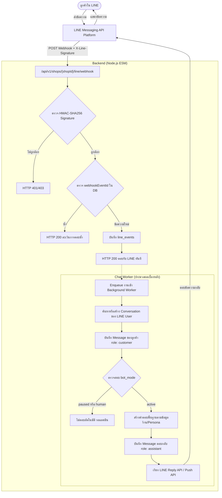

# แผนการพัฒนา: ข้อ 5. เชื่อม LINE และจัดเก็บข้อความ

แผนงานนี้ครอบคลุมการพัฒนาระบบรับส่งข้อความผ่าน LINE Messaging API, Webhook, การตรวจลายเซ็น (Signature Verification), การป้องกันข้อความซ้ำ (Event Deduplication), การสร้าง/ผูก Conversation และ Message แยกตามร้าน (Tenant-scoped), และการประมวลผลการตอบกลับผ่าน Worker

---

## 1. ภาพรวมสถาปัตยกรรม (Architecture Overview)

---

## 2. องค์ประกอบทางเทคนิคที่จะสร้างและแก้ไข

### 2.1 ฐานข้อมูล (Database Migrations)

สร้างไฟล์ migration ใหม่ `migrations/002_line_integration.sql`:

1. **`line_channels`**: เก็บการตั้งค่า LINE Messaging API ของแต่ละร้าน (One-to-One กับ `shops`)
   - `shop_id` (TEXT PRIMARY KEY, REFERENCES shops(id) ON DELETE CASCADE)
   - `channel_id` (TEXT)
   - `channel_secret` (TEXT NOT NULL)
   - `channel_access_token` (TEXT NOT NULL)
   - `destination_user_id` (TEXT) — Bot User ID สำหรับ map กรณีเรียก webhook รวม
   - `created_at` (TEXT NOT NULL)
   - `updated_at` (TEXT NOT NULL)
2. **`line_events`**: บันทึกประวัติเหตุการณ์เพื่อกันการประมวลผลซ้ำ (Event Deduplication / Idempotency)
   - `event_id` (TEXT PRIMARY KEY) — เก็บ `webhookEventId` จาก LINE
   - `shop_id` (TEXT NOT NULL REFERENCES shops(id) ON DELETE CASCADE)
   - `event_type` (TEXT NOT NULL) — เช่น `message`, `follow`, `unfollow`
   - `reply_token` (TEXT)
   - `status` (TEXT NOT NULL CHECK in (`received`, `completed`, `failed`, `ignored`))
   - `created_at` (TEXT NOT NULL)

---

### 2.2 โมดูลจัดการ LINE (`src/line.mjs`)

สร้างโมดูลเฉพาะสำหรับ LINE โดยใช้เฉพาะฟังก์ชันมาตรฐานของ Node.js (`node:crypto`, `fetch`):

- `verifyLineSignature(rawBody, signature, channelSecret)`: คำนวณ HMAC-SHA256 แล้วเปรียบเทียบด้วย `crypto.timingSafeEqual` เพื่อความปลอดภัยจากการโจมตีแบบ timing attack
- `sendLineReply(channelAccessToken, replyToken, messages)`: เรียก `https://api.line.me/v2/bot/message/reply`
- `sendLinePush(channelAccessToken, toUserId, messages)`: เรียก `https://api.line.me/v2/bot/message/push` (กรณี replyToken หมดอายุ)
- `fetchLineUserProfile(channelAccessToken, userId)`: ดึงชื่อโปรไฟล์ลูกค้าเพื่อนำมาเป็น `customer_name` ในห้องแชต

---

### 2.3 โมดูล Worker และคิวประมวลผล (`src/worker.mjs`)

- ทำ In-memory Async Job Queue จัดการงานประมวลผลข้อความเบื้องหลัง
- รับงานจาก webhook แล้วทำงานแบบ asynchronous เพื่อให้ webhook สามารถส่ง HTTP 200 ตอบ LINE ได้ทันทีภายในระดับมิลลิวินาที (ป้องกัน LINE Timeout & Retry)
- ตรวจสอบ `bot_mode`:
  - หากห้องแชตเป็น `active` -> ตอบกลับอัตโนมัติ
  - หากห้องแชตเป็น `paused` หรือ `human` -> บันทึกเฉพาะข้อความลูกค้า ไม่ส่งข้อความตอบกลับ เพื่อให้มนุษย์เข้ามาตอบแทน (สอดคล้องกับข้อ 10 Handover)
- วางโครง Interface `generateBotResponse({ shop, conversation, messageText })` ให้ยืดหยุ่น เพื่อพร้อมเสียบ RAG และ Gemini/OpenAI ในขั้นตอนที่ 7 และ 8

---

### 2.4 API Endpoints และ Contract (`src/contracts.mjs`, `src/app.mjs`, `src/service.mjs`)

เพิ่ม API endpoints ตามสเปก REST + OpenAPI:

1. **`POST /api/v1/shops/{shopId}/line/webhook`**:
   - รับ Webhook จาก LINE Platform
   - อ่าน Raw Request Body เพื่อตรวจ `X-Line-Signature`
   - ตรวจสอบ Deduplication ด้วย `webhookEventId`
   - ส่งคืน HTTP 200 ทันที
2. **`GET /api/v1/shops/{shopId}/line/config`**:
   - ดึงสถานะการเชื่อมต่อ LINE ของร้าน (เจ้าของร้านเท่านั้น)
   - ปิดบัง secret (masking) เช่น `******abcd` เพื่อความปลอดภัย
   - ส่งคืน URL Webhook สำหรับให้เจ้าของร้านนำไปใส่ใน LINE Developers Console
3. **`PUT /api/v1/shops/{shopId}/line/config`**:
   - บันทึก `channel_secret` และ `channel_access_token`
4. **`POST /api/v1/shops/{shopId}/line/simulate`**:
   - Endpoint สำหรับนักพัฒนาหรือจำลองเหตุการณ์ส่งข้อความ LINE ในสภาพแวดล้อม Local เพื่อทดสอบได้โดยไม่ต้องต่อ ngrok หรือ domain ภายนอก

---

### 2.5 หน้าจอตั้งค่า LINE ใน Web UI (`public/app.html`, `public/app.js`)

- เพิ่มแท็บ / ส่วน **"การเชื่อมต่อ LINE Official Account"** ในหน้าตั้งค่าธุรกิจ (`#business-settings-view`):
  - แสดง Webhook URL พร้อมปุ่มคัดลอก (Copy)
  - ช่องกรอก Channel Secret และ Channel Access Token
  - ปุ่มบันทึกการตั้งค่า
  - ปุ่มจำลองการส่งข้อความทดสอบ (Test Webhook Simulation) เพื่อให้เห็นว่าข้อความวิ่งเข้าห้องสนทนาจริง

---

## 3. แผนการตรวจสอบและทดสอบ (Verification Plan)

### Automated Tests (`tests/line.test.mjs` & `tests/api.test.mjs`):

1. **Signature Verification Test**:
   - ยิง webhook ด้วย signature ที่ถูกต้อง -> ตอบรับ 200
   - ยิง webhook ด้วย signature ปลอม / ผิด -> ตอบกลับ 401 Unauthorized
2. **Event Deduplication Test**:
   - ส่งข้อความเหตุการณ์เดียวกัน (`webhookEventId` เดียวกัน) 2 ครั้ง
   - ตรวจสอบว่าระบบบันทึกข้อความและตอบกลับเพียง **ครั้งเดียวเท่านั้น** ไม่เกิดการตอบซ้ำ
3. **Conversation & Message Isolation Test**:
   - ลูกค้า LINE คนเดียวกันส่งข้อความซ้ำ -> ข้อความต่อท้ายใน conversation เดิม
   - ลูกค้าของคนละร้าน (`shop-coffee` vs `shop-flower`) ต้องแยกบทสนทนาและไม่ปนกัน
4. **Bot Mode Guard Test**:
   - เมื่อตั้งค่า `bot_mode = 'human'` หรือ `'paused'` -> ข้อความลูกค้าถูกบันทึก แต่ระบบไม่สร้างข้อความตอบกลับของ assistant
5. **Contract Check**:
   - รัน `node scripts/openapi.mjs --check` เพื่อยืนยันว่า OpenAPI spec สอดคล้องกับ API จริง 100%
   - รัน `node --experimental-sqlite --test` ต้องผ่านครบทุกกรณี

---

## 4. สิ่งที่ต้องการสอบถามหรือขอความเห็นชอบ (User Review Required)

> [!NOTE]
> 1. ในขั้นที่ 5 นี้ การตอบกลับของ Bot จะเป็นการตอบข้อความตอบรับเบื้องหลัง (Rule-based / Greeting พร้อมข้อมูลร้านค้า) ตามข้อกำหนดที่ระบุว่า "รับ-ตอบได้ และมีประวัติถูกห้อง" ก่อนที่จะเชื่อมกับโมเดล RAG / Gemini ในข้อ 7 และ 8 ตามแผนงาน
> 2. Webhook URL จะเปิดให้บริการที่เส้นทาง:
>    `POST /api/v1/shops/{shopId}/line/webhook`
>    ซึ่งทำให้แต่ละร้านสามารถนำ URL ประจำร้านตนเองไปใส่ใน LINE Developers Console ได้โดยตรงและเป็นอิสระต่อกัน
