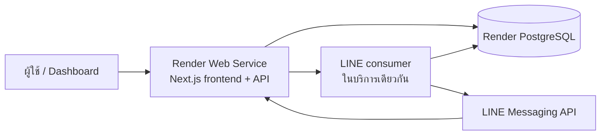

# แผนย้าย SQLite ไป PostgreSQL และ Deploy บน Render

> อัปเดต 20 ตุลาคม 2026: แผน Render ด้านล่างเป็นบันทึกเดิม ผู้ใช้เลือก [รัน local ด้วย PostgreSQL](local-only-decision.md) และยืนยันว่าไม่มีไฟล์ SQLite ต้นทาง จึงไม่มีงานนำเข้าหรือ deploy ในเป้าหมายปัจจุบัน

วันที่จัดทำ: 6 ตุลาคม 2026 (Asia/Bangkok)
โปรเจกต์: SMB Chatbot Platform — `Ai_Chatbot_SMBS2`
สถานะ: แผนสำหรับนำไปพัฒนา ยังไม่ได้เปลี่ยนฐานข้อมูลหรือสร้างบริการ Render

## 1. เป้าหมายและผลลัพธ์

ย้าย persistence ของแอปจาก SQLite ไป PostgreSQL โดยให้ Next.js frontend และ backend อยู่ใน Render Web Service ตัวเดียว และใช้ Render PostgreSQL แยกอีกหนึ่งบริการ

ผลลัพธ์ที่ต้องได้:

- ข้อมูลผู้ใช้ ร้านค้า สมาชิก ความรู้ บทสนทนา ข้อความ และการตั้งค่า LINE ยังคงอยู่หลัง restart หรือ deploy
- ผู้ใช้เดิมใช้รหัสผ่านเดิมได้ และข้อมูลแต่ละร้านยังถูกแยกตามสิทธิ์เดิม
- หน้าเว็บ, URL ของ API, HTTP status และ JSON contract เดิมยังใช้งานได้
- โค้ดฐานข้อมูลเป็น async และรองรับหลายคำขอพร้อมกันอย่างถูกต้อง
- การรับ LINE webhook บันทึก event และงานลงฐานข้อมูลก่อนตอบสำเร็จ
- มีวิธี migration, นำเข้าข้อมูล, ตรวจสอบ, deploy และย้อนกลับที่ทดสอบแล้ว

### ขอบเขต

รวมการปรับ database layer, SQL/schema, authentication, services, LINE worker, scripts, tests, CI, เอกสาร และ configuration สำหรับ Render

ไม่รวมการแยก frontend/backend เป็นสอง repository, เปลี่ยน framework/Pages Router, เพิ่ม ORM, RAG, embedding, AI provider ใหม่, ระบบ reset password หรือระบบจัดการคิวผ่านหน้าเว็บ

เอกสารนี้มีขั้นตอนสร้างบริการที่มีค่าใช้จ่ายสำหรับวัน deploy จริง แต่การจัดทำแผนไม่ได้สร้างบริการหรือสมัครแพ็กเกจให้ผู้ใช้

## 2. สภาพโปรเจกต์ที่ตรวจพบ

| ส่วน | ปัจจุบัน | ผลต่อการย้าย |
|---|---|---|
| Runtime | Node.js `>=24.19.0 <25`, ESM | คงสาย Node 24 และใช้เวอร์ชันเดียวกันใน local, CI และ Render |
| Framework | Next.js `16.3.5`, React `19.2.x`, Pages Router | Deploy แบบ Node Web Service และอ่าน docs ของ Next ที่ติดตั้งก่อนแก้โค้ด |
| Package manager | `packageManager: npm@11.19.0` | ใช้ npm เป็นมาตรฐานของแผนนี้ |
| Lockfiles / CI | มีทั้ง npm/pnpm lockfile; CI ใช้ pnpm | ปรับ CI และเอกสารให้ใช้ npm แล้วเลิกดูแล pnpm lockfile ในขั้น implementation |
| Database | `node:sqlite` / `DatabaseSync` | เปลี่ยนเป็น `pg` และ query แบบ async |
| Config | `DATABASE_PATH=./data/chatbot.sqlite` | เปลี่ยน runtime เป็น `DATABASE_URL`; path เก่าใช้เฉพาะเครื่องมือย้ายข้อมูล |
| Migration | 3 ไฟล์ SQL, checksum, รันอัตโนมัติเมื่อเปิด DB | สร้าง PostgreSQL migration แยก และรันผ่านคำสั่งโดยเฉพาะ |
| Transactions | `BEGIN IMMEDIATE` และ callback synchronous | ต้องใช้ PostgreSQL client เดียวตลอด transaction และ await callback |
| Schema | `STRICT`, `PRAGMA`, `COLLATE NOCASE`, `strftime`, `GLOB` | ต้องแปลง syntax และ constraints ไม่สามารถนำ SQL เดิมไปรันตรง ๆ |
| IDs | มีทั้ง UUID และข้อความ เช่น `shop-coffee` | คงเป็น TEXT ไม่บังคับเปลี่ยนทุก ID เป็น UUID |
| เวลา | TEXT รูปแบบ ISO UTC | ใช้ `TIMESTAMPTZ` และส่ง API เป็น ISO UTC รูปแบบเดิม |
| Authentication | scrypt password hash, opaque bearer token, token hash ใน sessions | ย้ายข้อมูล hash เดิมได้ ไม่ต้องเปลี่ยนวิธี login |
| Tenant scope | membership check, shop-scoped query, composite FK | ต้องรักษาทั้ง application checks และ FK |
| LINE queue | array ในหน่วยความจำ + `setImmediate` | ต้องมีคิวถาวรก่อนรับข้อความจริงบน Render |
| Start | `next start --hostname 127.0.0.1` | เปลี่ยนเป็น `0.0.0.0` และรับพอร์ตจาก Render |
| Health | `/api/health`; `/health` เป็น rewrite | ใช้ `/api/health` เป็น health check ที่ตรวจ DB จริง |
| Git remote | มี `origin` บน GitHub แล้ว | เชื่อม repository เดิมกับ Render ไม่ต้องสร้าง repository ใหม่ |

ตารางธุรกิจที่ต้องย้ายมี 9 ตาราง: `users`, `shops`, `shop_memberships`, `sessions`, `knowledge_entries`, `conversations`, `messages`, `line_channels`, `line_events` ส่วน `schema_migrations` เป็นประวัติ migration ของแต่ละ engine และไม่ย้ายทับกัน

README และเอกสารสถาปัตยกรรมบางส่วนยังกล่าวว่าไม่มี remote หรือ LINE เป็นงานอนาคต จึงต้องปรับตามสถานะจริงในขั้น implementation

## 3. การตัดสินใจและค่าเริ่มต้น

### 3.1 สถาปัตยกรรมเป้าหมาย



- Production เริ่มด้วย paid Web Service 1 instance และ paid PostgreSQL 1 instance
- เลือก Singapore สำหรับผู้ใช้หลักในไทย และให้แอปกับ DB อยู่ region เดียวกัน หาก region นี้เลือกไม่ได้ ให้หยุดขั้นสร้างบริการและเลือก region ที่ใกล้ผู้ใช้ร่วมกันก่อน
- คง origin เดียวกัน จึงยังไม่ต้องเพิ่ม CORS หรือ API base URL ข้ามบริการ
- แอปใช้ Internal Database URL; เครื่องนักพัฒนาและเครื่องนำเข้าข้อมูลใช้ External Database URL
- ใช้ PostgreSQL 18 ทั้ง development, CI และ production เพื่อไม่ให้ผลการทดสอบต่างกันตาม major version
- ใช้ไลบรารี `pg` โดยไม่เพิ่ม ORM ในรอบนี้; เลือกรุ่น stable ที่รองรับ Node 24 และ pin รุ่นที่ทดสอบแล้วใน package/lockfile
- ใช้ PostgreSQL เป็น runtime หลักทั้ง local และ production หลังย้ายสำเร็จ ไม่รักษา SQLite/PostgreSQL dual runtime
- เก็บ migrations SQLite เดิมไว้อ้างอิงและตรวจ source; `node:sqlite` เหลือเฉพาะเครื่องมือ backup/import และ migration tests ที่อ่าน source
- ค่าเริ่มต้นคือเก็บข้อมูลเดิมทั้งหมด รวม sessions ที่ยังมีอายุ และคง ID, password hash, token hash เดิม

Render แนะนำให้แอปและฐานข้อมูลอยู่ region เดียวกันเพื่อใช้เครือข่ายภายใน ดู [การเชื่อมต่อ Render PostgreSQL](https://render.com/docs/postgresql-creating-connecting)

### 3.2 งบประมาณ

ใช้งบประมาณเบื้องต้นจากที่หารือไว้: Web Service เริ่มประมาณ $7/เดือน และ PostgreSQL compute เริ่มประมาณ $6/เดือน รวมประมาณ $13/เดือนก่อน storage, usage เกินโควตา, ภาษี, อัตราแลกเปลี่ยน, โดเมน และบริการภายนอก ตัวเลขนี้เป็นงบประมาณสำหรับวางแผน ต้องตรวจราคาจริงก่อนสร้างบริการที่ [Render Pricing](https://render.com/pricing)

เริ่มจากขนาดเล็กและปรับตาม RAM/CPU/connection/latency ที่วัดได้ ไม่ถือว่าแพ็กเกจเริ่มต้นรับประกันรองรับผู้ใช้ทุกระดับ

Free ใช้สำหรับทดลองได้ แต่ web service พักเมื่อไม่มี traffic 15 นาที และ PostgreSQL ฟรีหมดอายุหลังสร้าง 30 วัน จึงเลือก paid สำหรับ production ตาม [ข้อจำกัดบริการฟรี](https://render.com/docs/free)

### 3.3 RLS และการแยกบริการ worker

รอบนี้คง tenant isolation ด้วย membership, shop-scoped queries และ composite FK พร้อม integration tests; ยังไม่เพิ่ม PostgreSQL RLS เพราะต้องออกแบบ role และ tenant context สำหรับ webhook/worker เพิ่มต่างหาก

เอกสารสถาปัตยกรรมเดิมเสนอ RLS สำหรับระยะขยาย ให้แก้เอกสารว่าถูกเลื่อนไปเป็นงานเสริม ไม่อ้างว่า PostgreSQL หรือการย้าย engine เปิด RLS ให้อัตโนมัติ

consumer เริ่มใน Web Service เดียวเพื่อคงค่าใช้จ่ายสองบริการ หากต้องแยก worker ในอนาคต ให้ใช้คิว PostgreSQL เดิมและปิด consumer ใน web instance ก่อนเปิด consumer บริการใหม่

## 4. ลำดับการทำงานและจุดผ่านแต่ละระยะ

| ระยะ | งานหลัก | ต้องผ่านก่อนเดินต่อ |
|---|---|---|
| A | เก็บ baseline และ backup | รู้ source ที่ใช้อยู่จริง และมี backup ที่เปิดอ่านได้ |
| B | PostgreSQL สำหรับพัฒนา + database layer | query/transaction/close ทำงานและไม่รั่ว connection |
| C | Schema และ migrations | schema สร้างใหม่ได้, รันซ้ำได้, checksum ตรวจได้ |
| D | เปลี่ยน API/auth/services/worker เป็น async | API regression และ tenant isolation ผ่าน |
| E | เครื่องมือนำเข้าข้อมูล | ซ้อมนำเข้าและเทียบข้อมูลครบ |
| F | คิว LINE ถาวร | ทดสอบ restart, duplicate และ delivery failure ผ่าน |
| G | CI + staging บน Render | build, migration, health และ smoke test ผ่าน |
| H | Cutover production | final import ผ่าน, LINE จริงผ่าน และมี rollback point |
| I | ตรวจหลังเปิดใช้งาน | monitor, backup/restore และเอกสารครบ |

## 5. ระยะ A — Baseline และสำรอง SQLite

### งานที่ต้องทำ

1. สร้าง branch งาน เช่น `codex/postgresql-render-migration` โดยเก็บ baseline commit ของเวอร์ชัน SQLite ไว้
2. อ่าน `AGENTS.md` และคู่มือใน `node_modules/next/dist/docs/` ที่เกี่ยวกับ CLI, self-hosting และ instrumentation ก่อนแก้โค้ด
3. รัน tests, API contract check และ build เดิม บันทึกผลและ failure ที่มีอยู่ก่อนย้าย
4. หา source จาก `DATABASE_PATH` หรือค่า default โดยตรวจ configuration ที่ใช้รันจริง ห้ามเดาว่า sample SQLite ใน docs คือฐานข้อมูลผู้ใช้จริง
5. บันทึก migration version/checksum, จำนวนแถวรายตาราง และตัวอย่าง flow ของสองร้านจาก source ที่ตรวจพบ
6. ตรวจขนาด DB, จำนวนร้าน/ข้อความ, timestamps, email ซ้ำเมื่อเทียบ case-insensitive, orphan rows และประวัติ event ที่ยังไม่จบ
7. เพิ่มเครื่องมือ backup แยก เช่น `db:backup:sqlite` ใช้ SQLite backup API กับฐานข้อมูลที่เปิดถูกต้อง; source ต้องมีอยู่แล้ว ห้ามเปิด path ที่ไม่มีแล้วสร้าง DB ว่างโดยไม่ตั้งใจ
8. backup ลง `data/backups/` ซึ่งไม่อยู่ใน Git พร้อม checksum SHA-256 และ manifest ที่ไม่มีข้อมูลลับ
9. เปิด backup แบบ read-only แล้วตรวจ `PRAGMA integrity_check` และ `PRAGMA foreign_key_check`

### ข้อควรระวังเรื่อง WAL

ห้ามคัดลอกเฉพาะ `.sqlite` ขณะแอปยังเขียนข้อมูล เพราะข้อมูลใหม่อาจอยู่ใน `-wal` ใช้ backup API สำหรับซ้อมย้าย ส่วน final snapshot ให้หยุดทุก process ที่เขียนข้อมูลรวม worker ก่อน backup

source จะถูกอ่านเท่านั้น ไม่รัน migration เพื่อแก้ source ระหว่าง export ถ้า source ยังไม่ถึง migration 003 ให้สร้างสำเนาทำงาน รัน SQLite migration เดิมบนสำเนา แล้วตรวจใหม่ก่อน import โดยเก็บ source ดั้งเดิมไว้

### เกณฑ์ผ่าน

- เปิด backup ได้, integrity/FK check ผ่าน และ manifest ระบุ source/version/เวลาสำรองชัดเจน
- ระบุได้ว่าข้อมูลเป็น demo หรือข้อมูลที่ต้องเก็บ และไม่มีการลบ/เขียนทับ source
- หากยังไม่มีข้อมูลจริง ให้ใช้ฐานข้อมูล demo สำหรับซ้อม แล้วสร้าง production DB ว่างโดยไม่เติม demo accounts

## 6. ระยะ B — PostgreSQL และ database layer

### 6.1 Development configuration

- ใช้ PostgreSQL 18 บนเครื่อง หรือ Docker Compose ที่มี named volume สำหรับ development
- ใช้ database แยกอย่างน้อย `chatbot_dev` และ `chatbot_test`; tests ห้ามใช้ production URL
- เพิ่ม `.env.example` สำหรับค่าที่ไม่มี secret และปรับ README ให้โหลด `.env` สำหรับ scripts เหมือนปัจจุบัน
- runtime ต้องหยุดพร้อมข้อความที่เข้าใจได้เมื่อไม่มี `DATABASE_URL` ห้าม fallback ไปสร้าง SQLite เงียบ ๆ

ค่าตั้งต้นที่เสนอ:

| ตัวแปร | Default / วิธีตั้ง | ใช้ทำอะไร |
|---|---|---|
| `DATABASE_URL` | ต้องตั้ง | PostgreSQL runtime ของ environment นั้น |
| `TEST_DATABASE_URL` | DB สำหรับ tests เท่านั้น | แยกข้อมูล integration tests |
| `DB_POOL_MAX` | `5` ต่อ process | จำกัดจำนวน connection เริ่มต้น |
| `DB_CONNECT_TIMEOUT_MS` | `5000` | จำกัดเวลารอ connection |
| `DB_QUERY_TIMEOUT_MS` | `10000` | จำกัด query runtime ปกติ |
| `DB_SSL_MODE` | `disable` local, `require` Render internal, `verify-full` Render external | กำหนด TLS อย่างชัดเจน |
| `SQLITE_SOURCE_PATH` | backup ที่มีอยู่จริง | ใช้เฉพาะ import/verify ไม่ใช่ runtime |
| `LINE_WORKER_ENABLED` | `false` build/test, `true` runtime ที่รับ LINE | เปิด consumer เฉพาะ process ที่ตั้งใจ |
| `APP_MAINTENANCE_MODE` | `false` | ปิด business traffic ระหว่าง final import |
| `NODE_ENV` | `production` บน Render | เปิด production behavior |
| `PORT` | Render กำหนดให้; local ใช้ 3000 | พอร์ต HTTP ไม่ hardcode |

TLS: local ใช้ plaintext เฉพาะฐานข้อมูล local; external ใช้ certificate verification; internal ของ Render ใช้ `require` ตามข้อจำกัด certificate ของบริการ ไม่ตั้ง `rejectUnauthorized: false` เป็นค่า global ทุก environment และไม่ผสม URL ssl options กับ `ssl` object โดยไม่ตรวจ precedence ของ `pg` ดู [Render connections](https://render.com/docs/postgresql-creating-connecting) และ [node-postgres SSL](https://node-postgres.com/features/ssl)

### 6.2 Interface ภายในที่กำหนด

เปลี่ยน database module ให้ใช้ async interface:

```text
openDatabase(config?) -> Promise<Db>
db.query(sql, params = []) -> Promise<{ rows, rowCount }>
transaction(db, async tx => result) -> Promise<result>
tx.query(sql, params = []) -> Promise<{ rows, rowCount }>
db.close() -> Promise<void>
```

- `openDatabase` สร้าง pool และตรวจ connectivity ไม่ apply migration หรือ seed
- runtime pool ใช้ singleton ต่อ Node process และมี initialization promise ป้องกันสร้างซ้ำเมื่อคำขอแรกมาพร้อมกัน
- ใน development รองรับ hot reload โดยไม่เพิ่ม pool ทุกครั้ง
- transaction acquire client, `BEGIN`, await callback, `COMMIT`; หากล้มเหลว `ROLLBACK`; release client ใน `finally`
- ทุก query ใน transaction ต้องใช้ `tx` ที่ส่งให้ ห้าม helper กลับไปเรียก pool กลางระหว่าง transaction ตาม [node-postgres transactions](https://node-postgres.com/features/transactions)
- ไม่ถือ PostgreSQL connection ระหว่าง scrypt, AI หรือ HTTP request ไป LINE
- pool error ต้องถูกจับและ log แบบไม่เปิดเผย connection URL/password
- scripts ปิด pool ทุกครั้ง ทั้งเมื่อสำเร็จและล้มเหลว

### เกณฑ์ผ่าน

query พร้อมกัน, commit, rollback, exception และ close ผ่าน tests โดย pool ไม่มี client ค้างหลัง rollback

## 7. ระยะ C — Schema และ migration PostgreSQL

### 7.1 โครงสร้าง migration

- คง migration SQLite เดิมทั้ง 3 ไฟล์ไว้ ห้ามแก้ checksum ของไฟล์ที่เคยใช้
- เพิ่ม `migrations/postgresql/001_initial.sql` เป็น baseline PostgreSQL จาก schema สุดท้ายหลัง SQLite migration 003
- เพิ่ม migration ถัดไปสำหรับ durable LINE jobs แยกจาก baseline เพื่อ review และ rollback ได้ง่าย
- `schema_migrations` ฝั่ง PostgreSQL มี `version`, `checksum`, `applied_at TIMESTAMPTZ`
- คำนวณ checksum หลัง normalize CRLF เป็น LF เช่นเดิม
- ใช้ advisory lock ของ PostgreSQL ควบคุม migration runner โดย acquire/release บน client เดียวกัน ครอบคลุมการตรวจและ apply ทุกไฟล์
- apply หนึ่ง migration ต่อหนึ่ง transaction; failure ต้อง rollback ทั้ง SQL และ migration record
- รันซ้ำข้ามไฟล์ที่ checksum ตรง; ถ้าต่างต้อง fail และให้เพิ่มไฟล์ใหม่
- runtime ตรวจว่า schema ที่จำเป็นมีอยู่และ fail ชัดเจนเมื่อยังไม่ได้ migrate โดยไม่เขียน DDL เอง

### 7.2 Mapping ของข้อมูล

| SQLite เดิม | PostgreSQL เป้าหมาย | ข้อกำหนด |
|---|---|---|
| TEXT ID | TEXT | เก็บ ID เดิม รวม ID ของ demo |
| TEXT ISO timestamp | TIMESTAMPTZ | UTC และ serialize เป็น `YYYY-MM-DDTHH:mm:ss.sssZ` |
| `COLLATE NOCASE UNIQUE` สำหรับ email | TEXT + unique index บน `lower(email)` | login/query ใช้ `lower(email)`; import ไม่เปลี่ยน email เดิมโดยพลการ |
| `STRICT` | native types และ CHECK | คงข้อจำกัดข้อมูลเดิม |
| `PRAGMA foreign_keys` | FK constraints | ไม่ใช้ PRAGMA |
| `strftime()` CHECK | timestamp type + input validation | ตรวจ source และ request format ก่อน insert |
| `GLOB` ของ token hash | regex CHECK | ต้องเป็น hex lowercase 64 ตัวอักษร |
| count จาก SQLite เป็น number | `COUNT(*)` PostgreSQL เป็น bigint | แปลงเฉพาะ count เป็น safe integer ก่อนส่ง API |

รายละเอียดที่ต้องรักษา:

- TEXT length, trim, NOT NULL, defaults, enum CHECK และ role/author CHECK
- `shop_memberships(shop_id, user_id)` เป็น composite PK
- `conversations(shop_id, id)` มี UNIQUE เพื่อใช้ composite FK
- ข้อความต้องอ้าง conversation ของร้านเดียวกัน และ author ที่เป็นสมาชิกของร้านนั้น
- `created_by` ของ knowledge ต้องอยู่ใน membership ของร้าน
- พฤติกรรม `ON DELETE CASCADE` และ `RESTRICT` ต้องตรงของเดิม
- คง index ของ membership, sessions expiry, knowledge pagination, conversation pagination, messages และ line events
- pagination เรียง `created_at, id` เหมือนเดิม; TEXT ID ใช้ collation `C` เพื่อให้ลำดับ tie-break คงที่
- ไม่เพิ่ม UNIQUE ของ open conversation ที่ทำให้ข้อมูลเก่าถูกปฏิเสธ; จัดการการสร้าง conversation พร้อมกันด้วย transaction lock ใน worker

ไม่ติดตั้ง `citext`, `pgvector` หรือ extension ที่ไม่จำเป็นกับการย้ายรอบนี้

### เกณฑ์ผ่าน

- สร้าง DB ใหม่และรัน migrations ได้ครบ; รันซ้ำไม่แก้ข้อมูลเดิม
- migration checksum เปลี่ยนและ migration ที่ SQL ผิดถูกตรวจ/rollback
- ทุก FK/CHECK และการ delete ผ่าน tests ทั้งกรณีถูกต้องและผิดร้าน
- วันที่/จำนวนแถวใน API เป็นชนิดและรูปแบบเดียวกับ contract เดิม

## 8. ระยะ D — เปลี่ยน API, auth, service และ worker เป็น async

### 8.1 การเปลี่ยนโค้ด

โมดูลหลักที่ต้องปรับ: database, auth, API runtime/request handler, business services, seed และ LINE worker ไม่จำกัดการแก้เฉพาะจุด import ของ driver

- เปลี่ยน `prepare/get/all/run` เป็น parameterized query ใช้ `$1`, `$2`, ...
- ระบุ column names ใน INSERT ทุกตัว ไม่พึ่งลำดับ column ของตาราง
- เปลี่ยน helper get/page/patch/membership เป็น async และ await ทุก caller
- request handler มี await service อยู่แล้ว แต่การหา session/membership ใน handler ยัง synchronous ต้องแก้ด้วย
- ปรับ `createSession` และ seed transaction ให้เป็น async
- ทำ serialization วันที่ส่วนกลาง; convert count เฉพาะจุด ไม่ override bigint parser ทั่วแอปโดยไม่ตรวจ overflow
- dynamic table/column names ต้องมาจาก internal allowlist ส่วนค่าจากผู้ใช้ต้อง bind parameters
- คง JSON envelope `data/meta/error/request_id`, status codes และ URL เดิม
- ไม่เพิ่ม CORS เนื่องจาก frontend/backend ยังอยู่ origin เดียว

### 8.2 Error และ concurrency

- สมัคร email พร้อมกัน: ให้ unique index เป็นตัวตัดสิน; map violation ของ email ไป HTTP 409 `EMAIL_EXISTS` แทน 500
- unique/FK/CHECK violation ต้องแปลงเฉพาะกรณีที่ business contract กำหนด ห้ามแปลงทุก `23505` เป็น email ซ้ำ
- ไม่ส่ง PostgreSQL error detail, SQL หรือค่าลับกลับ browser
- การสร้างร้าน+owner membership, สมัครผู้ใช้+session และเพิ่มข้อความ+updated_at ต้อง atomic
- การตรวจสิทธิ์ยังคืน 404 เมื่อเป็นข้อมูลของร้านอื่น และ 403 สำหรับ role ไม่ถึงตาม behavior เดิม
- การตั้งค่า LINE พร้อมกันใช้ upsert/lock ที่ไม่ทำให้ token/secret ที่ละไว้ถูกเขียนทับด้วย null
- เปลี่ยน health check เป็น await `SELECT 1`; DB ติดต่อไม่ได้ต้องคืน non-2xx พร้อม error ที่ไม่มี secret

### 8.3 Demo seed และ simulator

- seed รันซ้ำได้ ไม่เขียนทับแถวที่มีอยู่ และยังปฏิเสธเมื่อ `NODE_ENV=production`
- ไม่รัน seed ใน build, pre-deploy, startup หรือ final import
- endpoint LINE simulator ใช้สำหรับ development/staging เท่านั้น production ต้องปิดให้คืน 404 ก่อนประมวลผล
- เก็บ contract สำหรับ simulator ไว้สำหรับ dev/test และระบุข้อจำกัด production ในเอกสาร API
- production ที่เริ่มใหม่ไม่มี demo account; สมัคร owner ผ่าน flow ปกติ

### เกณฑ์ผ่าน

API integration เดิมทั้งหมดผ่านบน PostgreSQL รวม tenant isolation, session expiry/logout, owner/agent, validation, pagination และ seed idempotency

## 9. ระยะ E — เครื่องมือนำเข้าข้อมูลเดิม

### 9.1 Commands ที่จะเพิ่ม

| Command | หน้าที่ |
|---|---|
| `npm run db:backup:sqlite` | สำรอง source SQLite เป็น snapshot และ manifest |
| `npm run db:migrate` | apply PostgreSQL migrations |
| `npm run db:import:sqlite -- --dry-run` | ตรวจ source/target และสร้างรายงาน โดยไม่เขียน target |
| `npm run db:import:sqlite` | นำข้อมูลจาก snapshot เข้า target ที่เตรียมไว้ |
| `npm run db:verify:import` | เทียบ source กับ target แบบ read-only |
| `npm run db:seed` | demo seed เฉพาะ development |

ชื่อคำสั่งทั้งหมดในส่วนนี้เป็น interface ที่ต้องสร้างใน implementation ยังไม่ใช่คำสั่งที่มีครบใน repository ปัจจุบัน

### 9.2 Preflight

1. source path ต้องมีจริง เปิด read-only และ schema หลัง migration 003 ต้องครบ
2. ใช้ SQLite snapshot เดิมตลอด import/verify ห้ามอ่าน live source ที่มีคนเขียน
3. target ต้องมี PostgreSQL migrations ครบและทั้ง 9 ตารางธุรกิจว่าง; ถ้าไม่ว่างให้ fail ห้าม upsert ทับข้อมูลจริง
4. ตรวจ timestamps ว่า parse ได้และ round-trip ISO ตรงเดิม; ตรวจ text ที่ PostgreSQL ไม่รับ เช่น NUL
5. ตรวจ email ซ้ำตาม `lower(email)` และ FK; พบข้อมูลผิดให้ report table/ID แล้วหยุด ห้ามแก้ข้อมูลเงียบ ๆ
6. แสดงเฉพาะ table counts, source checksum และ target hostname/database ที่ไม่รวม username/password
7. dry-run ไม่รัน DDL, seed หรือแก้ schema_migrations

### 9.3 ลำดับ import

```text
users
shops
shop_memberships
sessions
knowledge_entries
conversations
messages
line_channels
line_events
```

- ใช้หนึ่ง target transaction สำหรับขนาดข้อมูล SMB ปัจจุบัน โดย insert เป็น batch และไม่โหลดทุกข้อความเข้าหน่วยความจำพร้อมกัน
- จัดการ timeout ของ import แยกจาก runtime query timeout; ไม่ใช้ค่า 10 วินาทีต่อ transaction รวมทั้งชุด
- หากขนาดข้อมูลทำให้ transaction เดียวยาวเกิน maintenance window ให้ปรับเป็นงาน import แบบ checkpoint ในแผนใหม่ก่อน final cutover ไม่สลับวิธีกลางทาง
- ใช้ explicit columns และเก็บ ID/password hash/token hash/LINE credentials เดิม
- ไม่คัดลอก SQLite schema_migrations ไป PostgreSQL
- imported line events มีไว้เป็นประวัติและ deduplication ไม่สร้าง jobs เพื่อ replay เหตุการณ์เก่า
- event เก่าที่ received/processing ให้รายงานเป็น unresolved; หลังย้ายไม่ส่ง LINE reply เก่าอัตโนมัติ เพราะไม่มี payload ครบและ token อาจใช้ไม่ได้
- เมื่อเกิด error rollback ทั้งชุด; rerun ได้เมื่อ target ยังว่าง ไม่ใช้ `--force` ที่ลบข้อมูลโดยอัตโนมัติ
- DB ที่ import ไป staging สำเร็จแล้วต้องแยกจาก DB สำหรับ final import; ไม่ reset production ด้วย DROP/TRUNCATE แบบอัตโนมัติ

### 9.4 Verification

- จำนวนแถวของทั้ง 9 ตารางตรง snapshot
- สร้าง checksum รายตารางจากรายการ column ที่กำหนด เรียง PK แบบคงที่ และ normalize timestamps เป็น ISO UTC ก่อน hash
- ตรวจชุด ID/ความสัมพันธ์และ samples ของสองร้าน รวมข้อความไทย, ข้อความยาว และค่า null
- เปรียบเทียบ password/token/LINE credential ด้วย hash ภายใน ไม่พิมพ์ค่าออก log
- ตรวจ orphan rows, owner membership และบทสนทนา/ข้อความข้ามร้าน
- สำหรับ line events unresolved เปรียบเทียบ raw history ก่อน จากนั้นสร้างรายงาน operational แยกโดยไม่เปลี่ยนสถานะย้อนหลังเงียบ ๆ
- manifest ระบุ source file checksum, per-table counts/checksums, target DB, migration versions, เวลาเริ่ม/จบ และผล verify

### เกณฑ์ผ่าน

ซ้อมนำเข้าจาก backup ไป DB ทดสอบได้ ตรวจข้อมูลตรงทั้งหมด และ failure กลางทางทำให้ target ไม่มีข้อมูลธุรกิจค้างจาก transaction นั้น

## 10. ระยะ F — คิว LINE ที่เก็บงานถาวร

ส่วนนี้เป็น gate ก่อนรับ LINE จริง ไม่จำเป็นสำหรับการทดลอง dashboard ด้วย PostgreSQL เพียงอย่างเดียว แต่ต้องทำก่อน production cutover ที่เปิด LINE

### 10.1 ตาราง jobs

เพิ่ม `line_jobs` แยกจากประวัติ `line_events`:

| ข้อมูล | รูปแบบ / หน้าที่ |
|---|---|
| `job_id` | TEXT PK |
| `shop_id`, `event_id` | FK ไป event ของร้านนั้น; UNIQUE `(shop_id, event_id)` |
| `payload` | JSONB ของ event ที่จำเป็น ไม่มี channel secret/access token |
| `status` | `pending`, `processing`, `completed`, `failed`, `unknown`, `ignored` |
| `attempts` | integer >= 0 |
| `available_at`, `received_at` | TIMESTAMPTZ สำหรับการ claim/ตรวจอายุ |
| `locked_at`, `lease_until`, `locked_by` | การถือสิทธิ์ประมวลผล |
| `delivery_state` | `pending`, `sending`, `sent`, `unknown` |
| `conversation_id`, `customer_message_id`, `reply_message_id`, `reply_text` | checkpoint ของการจัดเก็บ/สร้างคำตอบ |
| `last_error_code`, `created_at`, `updated_at` | ข้อผิดพลาดที่ตัด secret และเวลาประมวลผล |

เพิ่ม composite UNIQUE `(shop_id, event_id)` ที่ line_events สำหรับ FK ของ jobs โดยยังรักษา global PK ของ `event_id` เดิมไว้ หาก ID เดียวกันปรากฏคนละร้านให้ reject/log collision ห้ามเปิดเผยข้อมูลร้านแรก

index jobs สำหรับ `status/available_at` และ expired lease; ตารางนี้เป็นข้อมูลภายใน ไม่เพิ่ม public endpoint ในรอบนี้

### 10.2 รับ webhook

1. รักษา `bodyParser: false` และการตรวจ signature จาก raw body เดิม
2. โหลด channel ของ shop จาก path ที่ถูกต้อง และตรวจ destination ถ้ามีค่าที่ใช้เทียบได้
3. ใน transaction เดียว insert event ด้วย `ON CONFLICT` และ insert job เฉพาะ text event ใหม่
4. `processed_count` คือจำนวน text event ใหม่ที่บันทึก jobs สำเร็จ; duplicate ไม่เพิ่ม count
5. event ประเภทที่ไม่รองรับเก็บเป็น ignored และไม่สร้าง job
6. text event ที่ไม่มีทั้ง webhookEventId/message ID หรือข้อมูลผู้ใช้ที่ประมวลผลได้ ให้ reject ตาม validation เดิม ไม่สร้าง ID สุ่มจน redelivery กลายเป็นงานใหม่
7. ตอบ 2xx หลัง commit เท่านั้น; DB failure ให้ non-2xx เพื่อให้ต้นทางมีโอกาส redeliver
8. request `events: []` สำหรับตรวจ webhook ต้องสำเร็จ โดยไม่สร้าง event/job

### 10.3 Consumer และการประมวลผล

- เริ่ม consumer ผ่าน Next.js instrumentation hook ตอน server runtime เริ่ม ไม่รอให้มี API request แรก
- ใช้ Node runtime guard และ `LINE_WORKER_ENABLED` เพื่อไม่เริ่ม consumer ระหว่าง build, edge runtime หรือ tests
- singleton consumer ต่อ process; ตั้ง concurrency 1 เริ่มต้น และ poll ทุก 1 วินาทีเมื่อ idle พร้อมปลุกเมื่อมีงานใหม่
- claim job ใน transaction สั้นด้วย `FOR UPDATE SKIP LOCKED`; lease เริ่มต้น 60 วินาที และ heartbeat ทุก 15 วินาที
- claim/renew/update ต้องตรวจ locked_by และสถานะ เพื่อไม่ให้ worker ที่เสีย lease ไปแล้วเขียน checkpoint ของงานคนอื่น
- lock ตาม shop/customer ใน transaction ที่หา/สร้าง conversation เพื่อกัน webhook คนเดียวกันสร้าง conversation พร้อมกัน
- ใช้ deterministic message IDs จาก `(shop_id, event_id, role)` และ insert idempotently เพื่อไม่เพิ่ม customer/assistant message ซ้ำเมื่อ recovery
- เก็บ customer message และ checkpoint ก่อนส่งออก และอ่าน bot_mode/status ใหม่ก่อนส่ง LINE
- โหลด credential จาก line_channels ตอนทำงาน ไม่เก็บ token/secret เพิ่มใน payload
- await `generateReply` เผื่อ implementation ในอนาคตเป็น async โดยไม่เพิ่ม AI provider ในรอบนี้
- จำกัด HTTP reply timeout 10 วินาที และไม่ถือ transaction ระหว่าง fetch
- ตั้ง application cutoff 45 วินาทีหลังรับ webhook สำหรับการเริ่ม reply เพื่อไม่เริ่มส่งงานที่ค้างนาน; cutoff นี้เป็น policy ของแอป ไม่ใช่การรับประกันอายุ reply token จาก LINE
- เมื่อเกิน cutoff ให้เก็บ customer message ตามปกติและปิด job เป็น failed ด้วยรหัส `REPLY_WINDOW_EXPIRED` ไม่ส่ง push message ทดแทนอัตโนมัติ
- retry อัตโนมัติเฉพาะข้อผิดพลาดชั่วคราวก่อนเริ่ม HTTP send เช่น DB connection ขัดข้อง สูงสุด 3 attempts, backoff 1 และ 3 วินาที และยังต้องไม่เกิน cutoff
- LINE non-2xx ที่ได้รับชัดเจนเป็น failed; timeout/disconnect/crash หลังเริ่ม send เป็น unknown และไม่ retry ส่งซ้ำอัตโนมัติ
- ก่อน HTTP call บันทึก `delivery_state=sending`; เมื่อ LINE ตอบสำเร็จบันทึก sent, assistant message และ job/event completed ใน transaction
- เกิด DB failure หลัง LINE สำเร็จ หรือ crash ระหว่างส่ง ต้องถือว่า delivery ไม่แน่นอน ไม่สร้าง assistant message ราวกับยืนยันส่งแล้ว
- expired lease ของงานก่อนส่งกลับไป pending ได้; งานที่เริ่ม sending แล้วเปลี่ยนเป็น unknown เพื่อให้ผู้ดูแลตรวจ ห้ามสัญญา exactly-once delivery ข้าม PostgreSQL และ LINE API
- ตรวจข้อความ unknown/failed ผ่าน log และ SQL สำหรับผู้ดูแลในเอกสาร ไม่มีการเพิ่มหน้า UI จัดการงานในรอบนี้

### 10.4 Restart และ shutdown

- เมื่อเริ่ม process ใหม่ต้องสแกนงาน pending/expired lease แล้ว recovery ตาม delivery state โดยไม่ต้องรอ webhook ใหม่
- graceful shutdown หยุด claim งานใหม่ รอ active job ภายในเวลาสูงสุด 15 วินาที แล้วคืน/ปล่อย lease ตามสถานะ ก่อนปิด pool
- ต้องทดสอบ Next.js signal lifecycle จริง ห้ามติดตั้ง handler ที่ทำให้ process ไม่ยอม exit
- ทั้ง deploy overlap และ process crash ต้องไม่มีการส่งซ้ำจาก consumer สองตัว
- เก็บงาน terminal/payload เพื่อ debug ตามระยะ retention 30 วัน แล้วล้าง payload/reply token ของงานที่จบ ส่วน event ID สำหรับ deduplication เก็บไว้; มี cleanup command สำหรับผู้ดูแล

ข้อจำกัด: durable queue ป้องกันงานที่ commit แล้วสูญหาย แต่ไม่ได้ทำให้ token LINE ที่หมดอายุกลับมาใช้ได้ และ LINE redelivery ไม่รับประกันว่าจะส่งครบทุกเหตุการณ์ ดู [รับ webhook](https://developers.line.biz/en/docs/messaging-api/receiving-messages/) และ [Messaging API reference](https://developers.line.biz/en/reference/messaging-api/)

### เกณฑ์ผ่าน

kill/restart หลัง enqueue, duplicate พร้อมกัน, crash ก่อน/หลัง send, bot paused/human, DB outage และ LINE failure ถูกจัดการตาม state ที่กำหนด ไม่มี silent loss หรือข้อความซ้ำจาก recovery

## 11. ระยะ G — CI และ staging บน Render

### 11.1 ปรับ CI

- ใช้ Node 24.19.0 และ npm 11.19.0 ให้ตรง manifest
- ใช้ `npm ci` จาก package-lock.json และเลิกขั้นตอน pnpm; นำ pnpm lockfile ออกจากการดูแลเมื่อทีมเปลี่ยนตามแผนนี้
- เพิ่ม PostgreSQL 18 service container พร้อม health check ใน GitHub Actions
- ให้ tests ใช้ TEST_DATABASE_URL โดยสร้าง schema แยกต่อ test suite และ cleanup เฉพาะ schema ที่ tests สร้าง
- ห้ามใช้ schema/table reset ร่วมกันเมื่อ tests รันขนาน
- แยก SQLite fixture tests สำหรับ backup/import ออกจาก PostgreSQL runtime integration tests
- build ต้องไม่ query DB, apply migrations, seed หรือเริ่ม consumer; ทดสอบ build ที่ไม่มี DATABASE_URL โดยมี `LINE_WORKER_ENABLED=false`
- รัน API contract check เดิม; เปลี่ยน contract เฉพาะ production restriction ของ simulator/validation ที่ตกลงในแผน และ regenerate OpenAPI ถ้าจำเป็น

### 11.2 ปรับ production scripts

ค่าเป้าหมายใน package.json:

```text
dev: next dev --hostname 127.0.0.1
build: node scripts/build.js
start: next start --hostname 0.0.0.0
```

เพิ่ม build wrapper แบบ cross-platform ที่เรียก Next CLI ของ package ที่ติดตั้งด้วย Node แล้วส่ง arguments `build --webpack` โดยตั้ง environment ของ child process เป็น `LINE_WORKER_ENABLED=false` เสมอ, inherit stdio และส่ง exit code กลับตรงผล build วิธีนี้ทำให้ build ปลอดภัยแม้ runtime environment ตั้ง worker เป็น true และใช้ได้ทั้ง Windows, CI และ Render

คง webpack ของโปรเจกต์ปัจจุบัน ไม่เปลี่ยน bundler ในงานย้ายฐานข้อมูล Next CLI อ่าน `PORT` จาก process environment; ไม่พึ่งค่า PORT ใน `.env` สำหรับการ bind server

### 11.3 สร้าง staging

1. เชื่อม repository เดิมบน GitHub กับ Render โดยเลือก branch/commit ที่ผ่าน CI
2. สร้าง PostgreSQL staging แยกจาก production และไม่ผูกกับ LINE channel ของร้านจริง
3. สร้าง Next.js Web Service; ใช้ hostname `0.0.0.0` และไม่เลือก Static Site เพราะมี API server
4. ตั้งค่าแอป:

| Setting | ค่า |
|---|---|
| Runtime | Node |
| Node version | 24.19.0 |
| Build Command | `npm ci && npm run build` |
| Pre-deploy Command | `npm run db:migrate` |
| Start Command | `npm start` |
| Health Check Path | `/api/health` |
| Instance count | 1 |
| Region | Singapore เหมือน DB |
| Auto deploy | ปิดระหว่าง cutover แรก; เปิดหลังผ่าน CI/การตรวจของทีม |

5. ตั้ง DATABASE_URL เป็น internal staging URL; secrets บันทึกใน Render environment ไม่ใส่ใน YAML/README
6. staging ที่ทดสอบ LINE/production ตั้ง LINE_WORKER_ENABLED=true ใน Render environment; build wrapper บังคับ false เฉพาะ child process ของ build ส่วน npm start รับค่าที่ตั้งจริง ไม่มี consumer ทำงานใน build/pre-deploy
7. staging ที่ไม่ต้องทดสอบ LINE ให้ consumer ปิด; หากทดสอบ live LINE ใช้ channel ทดสอบแยกและเปิด consumer เฉพาะ staging นั้น
8. จำกัด external DB access เป็น IP ที่ต้องใช้นำเข้า/ดูแล และตรวจ TLS ก่อนนำเข้าข้อมูล
9. เพิ่ม `render.yaml` สำหรับ production configuration เดียวกัน โดยอ้าง database connection ผ่าน Render reference ไม่ใส่ credentials และไม่ apply blueprint ไปสร้างบริการซ้ำ

Pre-deploy มีสำหรับ paid services และเหมาะกับ migration ตาม [Render Deploys](https://render.com/docs/deploys) ถ้าทดลอง free ให้รัน migration แยกก่อน deploy ไม่ย้าย migration เข้า build เป็นทางลัด

### 11.4 Staging smoke test

- `/`, `/app`, `/docs`, `/api/health` และ `/openapi.json` เปิดได้
- สมัคร/login, สร้างร้าน, CRUD knowledge, conversations/messages และเปลี่ยน bot_mode ผ่าน
- ทดสอบสิทธิ์สองร้าน, owner/agent และ token หมดอายุ
- ซ้อม import บน DB staging/test target ที่ว่าง แล้ว verify
- restart และ redeploy แล้วยังมีข้อมูลเดิม
- ถ้าใช้ channel ทดสอบ ให้ Verify webhook, ส่งข้อความจริง และตรวจ event/job/customer/assistant message
- ตรวจว่า logs ไม่มี database URL, password, bearer token, LINE credentials หรือ payload ข้อความทั้งก้อน

### เกณฑ์ผ่าน

CI ผ่านและ staging รัน production build ได้จริง รวม import rehearsal และ restart recovery ก่อนสร้าง final snapshot

## 12. ระยะ H — Production cutover

### 12.1 เตรียมก่อนวันย้าย

- กำหนด maintenance window จากเวลาที่วัดในการซ้อม import + verify + smoke test และเผื่อเวลาอย่างน้อยเท่าระยะซ้อมอีกหนึ่งรอบ
- เตรียม PostgreSQL production ที่มี schema ครบและยังไม่มีข้อมูลธุรกิจ
- deploy web service ใหม่ใน maintenance mode, consumer ปิด และยังไม่ชี้ LINE จริงมาที่แอปใหม่
- APP_MAINTENANCE_MODE ให้ health ยังทำงาน แต่ business API ตอบ HTTP 503 ก่อนเกิด DB side effect; webhook ไม่ตอบสำเร็จหากยังไม่พร้อมบันทึก
- เตรียม baseline SQLite commit, backup ล่าสุด, PostgreSQL release commit, webhook URL เดิม และผู้ดูแล cutover
- ถ้าแอปเดิมอยู่แค่ localhost/tunnel ให้ระบุว่ามี endpoint ใดกำลังรับ LINE และปิด writer ทุกตัว ไม่สมมติว่ามีโฮสต์ production เดิม
- เปิด webhook redelivery ของ channel ตามความสามารถ LINE ที่ใช้ และยอมรับว่าการปิดบริการช่วงย้ายอาจมีข้อความเข้ามาที่ต้องตรวจหลังเปิด

### 12.2 Runbook วันย้าย

1. เปิด maintenance ที่ระบบเดิม ปฏิเสธการเขียนใหม่รวม LINE webhook และ simulator
2. drain งานใน memory ที่กำลังทำจนจบ แล้วหยุด process/worker ที่เขียน SQLite ทุกตัว
3. ทำ final SQLite backup และตรวจ integrity/FK/counts/checksum
4. ยืนยัน target production เป็น DB ที่ตั้งใจและตารางธุรกิจว่าง
5. รัน dry-run โดยชี้ SQLITE_SOURCE_PATH ไป final snapshot และ DATABASE_URL ไป external production URL
6. รัน import และ verify; ไม่รัน seed
7. บันทึก manifest เป็นหลักฐาน final import
8. restart app ใหม่แบบ maintenance และ consumer ปิด ตรวจ health และ read-only queries จากผู้ดูแล
9. ผ่าน gate ข้อมูลแล้วจึงปิด maintenance เปิด consumer และทดสอบ login/ร้าน/ความรู้/บทสนทนา
10. ตั้ง webhook ใน LINE Developers Console ต่อร้านเป็น:

```text
https://<RENDER_HOST>/api/v1/shops/<SHOP_ID>/line/webhook
```

11. เปิด Use webhook, กด Verify และตรวจการเชื่อมต่อจาก dashboard; test request ที่ events ว่างต้องผ่าน
12. ส่งข้อความจากบัญชีทดสอบจริง ตรวจรับ event/job, customer message, การตอบกลับและ assistant message
13. ตรวจ duplicate redelivery และ backlog/unknown/failed โดยไม่ replay imported events
14. หากมี custom domain ให้สลับ traffic เมื่อแอปพร้อม; หากใช้ Render URL ให้ผู้ใช้เข้า URL ใหม่
15. บันทึกเวลาที่เริ่มรับ write ใหม่ เป็นขอบเขตสำคัญสำหรับ rollback
16. เก็บระบบ SQLite เดิมปิดการเขียนต่อไป ไม่ให้มีสองฐานข้อมูลรับข้อมูลจริงพร้อมกัน

### เงื่อนไขหยุดก่อนเปิด write

- import/verify ไม่ผ่าน, counts/hash ต่าง หรือ integrity/FK ผิด
- health ไม่ผ่าน, migrations ไม่ครบ หรือ pool ล้มเหลว
- login/tenant isolation/owner permissions ผิด
- พบการส่งข้อความข้ามร้าน, duplicate reply จาก consumer หรือคิวไม่ฟื้นหลัง restart

## 13. แผนย้อนกลับ

### 13.1 ก่อน PostgreSQL รับข้อมูลใหม่

1. คง maintenance ของระบบใหม่และปิด consumer
2. ไม่แตะ source/backup SQLite
3. คืน traffic และ LINE webhook ไป baseline SQLite เดิมเมื่อยืนยันว่าระบบใหม่ยังไม่มี write ใหม่
4. เปิดระบบเดิมด้วย DB เดิมและ commit เดิม
5. เก็บ PostgreSQL target/manifest/logs ไว้ตรวจสาเหตุ ไม่ลบอัตโนมัติ

### 13.2 หลัง PostgreSQL รับข้อมูลใหม่แล้ว

ห้ามเปลี่ยนกลับ SQLite backup ทันที เพราะจะทำให้ users, sessions, messages และเหตุการณ์ใหม่หาย หรือประมวลผล LINE ซ้ำ

แนวทาง default คือแก้ปัญหาบน PostgreSQL ต่อไป:

- ปัญหาโค้ด: rollback ไป release ที่ยังรองรับ PostgreSQL และ schema ปัจจุบัน
- ปัญหา schema: ใช้ migration แก้ไขไปข้างหน้า; ห้ามย้อนกลับด้วย DROP COLUMN/TABLE ที่ข้อมูลใหม่ใช้อยู่
- ปัญหาข้อมูล: เปิด maintenance, หยุด writers, backup PostgreSQL ล่าสุด และ restore ไป DB แยกเพื่อเทียบก่อนเปลี่ยน target
- การกลับ SQLite หลังมี write ใหม่ต้องมีแผน reverse export/reconciliation และการจัดการ LINE delivery ใหม่ก่อน จัดเป็นงานแยก ไม่อยู่ใน rollback อัตโนมัติของรอบนี้

ทุก PostgreSQL migration หลัง cutover ต้องรองรับ code เวอร์ชันก่อนระหว่าง deploy overlap โดยใช้แนวเพิ่มก่อนแล้วค่อยเลิกใช้งานใน release ถัดไป

## 14. Test matrix และ acceptance criteria

| กลุ่ม | สถานการณ์สำคัญ | ผลที่คาด |
|---|---|---|
| Database | ต่อ DB สำเร็จ/ล้มเหลว, missing URL, close | fail ชัดเจน ไม่มี SQLite fallback หรือ pool leak |
| Transaction | exception กลาง create shop/message/session | ไม่มีแถวบางส่วนค้าง |
| Migration | fresh, rerun, checksum เปลี่ยน, concurrent runners, SQL ผิด | apply ครั้งเดียวหรือ rollback และ fail |
| Types | ISO UTC, ไทย/Unicode, null, numeric pagination totals | JSON ตรง contract |
| Auth | password เดิม, imported sessions, expiry/logout | พฤติกรรมเดิมและไม่เปิดเผย hash |
| Email | ตัวพิมพ์ต่างกันและ register พร้อมกัน | มีบัญชีเดียว อีกคำขอได้ 409 |
| Tenant | resource ของอีกร้าน, customer external ID เดียวกัน, owner/agent | ไม่มีข้อมูล/ข้อความข้ามร้าน |
| Constraints | FK, author role, invalid enum/text lengths, delete cascade/restrict | reject/ลบตาม schema เดิม |
| Import | dry-run, source ผิด, target ไม่ว่าง, interruption, checksum | ไม่ทำลาย source และไม่มี partial import |
| Seed | rerun, แถวเดิมถูกแก้, production | ไม่เขียนทับ และปฏิเสธ production |
| Webhook | raw signature, invalid signature, events ว่าง, unsupported event | status/side effects ถูกต้อง |
| Duplicate | event เดียวกันพร้อมกันหลายคำขอและ redelivery | event/job/customer message ไม่ซ้ำ |
| Worker | restart ก่อนส่ง, lease หมด, overlap deploy | recovery โดยไม่รอ request ใหม่ |
| Delivery | LINE non-2xx, timeout, DB failure หลัง send, token window หมด | failed/unknown ชัดเจนและไม่ retry ส่งซ้ำ |
| Bot state | paused/human/closed หรือเปลี่ยนก่อนส่ง | ไม่ส่ง assistant อัตโนมัติผิดโหมด |
| Lifecycle | build ไม่มี DB/worker, graceful shutdown, hard crash | build ไม่ side-effect และคิวฟื้นได้ |
| Deploy | PORT, hostname, health, restart/redeploy | service ติดต่อได้และข้อมูลอยู่ครบ |
| Production | simulator disabled, no demo seed, no credentials in logs | endpoint ทดสอบไม่สร้างข้อความในร้านจริง |
| Recovery | backup/restore rehearsal, rollback ก่อนเปิด write | คืนระบบได้ตาม runbook |

Acceptance checklist:

- [ ] `npm test` ผ่านบน PostgreSQL โดยไม่ข้าม tests เพราะไม่มี DB
- [ ] `npm run api:check` ผ่าน
- [ ] `npm run build` ผ่านโดยไม่เริ่ม consumer หรือแก้ DB
- [ ] runtime ไม่มีการเรียก `DatabaseSync` หรือ synchronous prepare เหลือ
- [ ] SQLite baseline migrations ไม่ถูกแก้ checksum
- [ ] constraints/tenant isolation และ API behavior เดิมผ่าน
- [ ] final snapshot/import verification มี manifest และตรงครบทุกตาราง
- [ ] user เดิม login ได้ด้วย password เดิม
- [ ] health, restart/redeploy และ LINE recovery ผ่าน staging
- [ ] production seed/simulator ถูกปิดตามแผน
- [ ] cutover/rollback และ backup restore ได้ซ้อมแล้ว
- [ ] ไม่มี secret/backup/ฐานข้อมูลถูก commit

## 15. หลังเปิดใช้งาน: monitoring และ backup

### ช่วง 24–48 ชั่วโมงแรก

- ดูจำนวน HTTP 5xx, DB errors, pool wait/connection count, query latency และ RAM/CPU
- ตรวจจำนวน pending jobs, oldest pending age, failed/unknown และจำนวน lease recovery
- ตั้ง alert เมื่อ health ล้มเหลวต่อเนื่อง 2 นาที หรือพบ job unknown มากกว่า 0 เพื่อให้ตรวจทันที
- เฝ้าดู oldest pending age มากกว่า 10 วินาที เพราะอาจกระทบการใช้ LINE reply token
- log ใช้ request_id, job/event ID และ error code ที่ไม่มี secret/payload เต็ม
- ตรวจ LINE failure/redelivery จาก LINE Console ร่วมกับ log ของแอป
- ตรวจจำนวนข้อความรายร้านเทียบกับ traffic จริง ไม่ถือว่า assistant row หมายถึงลูกค้าได้รับเมื่อ delivery state ไม่ยืนยัน

### Backup และ retention

- เปิดและตรวจความสามารถ backup/recovery ของ paid Render PostgreSQL ตามแพ็กเกจที่เลือก ดู [Render Postgres Backups](https://render.com/docs/postgresql-backups)
- ทำ logical export ก่อน schema/data migration ที่สำคัญ และเก็บนอก filesystem ของ Web Service
- เก็บ final SQLite snapshot แบบจำกัดผู้เข้าถึงอย่างน้อย 30 วันหลังย้าย โดยไม่ใส่ใน Git
- ทดสอบ restore PostgreSQL backup ไป DB แยกและรัน verification/smoke test ก่อนอ้างว่ากู้ข้อมูลได้
- หลังผ่านช่วงตรวจสอบ จัดการ backup ตามนโยบาย retention ของข้อมูลลูกค้า และไม่ลบ baseline เพียงเพราะ deploy สำเร็จครั้งแรก

เป้าหมายสำหรับ cutover คือไม่มีข้อมูล SQLite ที่ commit แล้วสูญหาย ส่วน RPO/RTO หลังใช้งานต้องบันทึกจาก backup plan ที่เปิดจริงและเวลาซ้อม restore ไม่สัญญาศูนย์ downtime หรือศูนย์ data loss โดยไม่มีหลักฐาน

## 16. Deliverables สำหรับ implementation

| Deliverable | รายละเอียด |
|---|---|
| Database module | pg pool, async query/transaction, TLS/config, lifecycle |
| PostgreSQL migrations | baseline 9 ตาราง, schema_migrations และ durable LINE jobs |
| Refactored services | API/auth/seed/LINE พร้อม async และ error mappings |
| Migration tools | backup, dry-run/import, verify และ manifest |
| LINE consumer | startup/recovery/leases/checkpoints/delivery uncertainty |
| Tests/CI | PostgreSQL 18, isolated test schemas, import fixtures และ failure cases |
| Render configuration | scripts, environment, health และ blueprint ที่ไม่มี secret |
| Operations guide | cutover, rollback, restore, monitoring และ job cleanup |
| Updated docs | README, architecture, API/ERD/CONTRIBUTING ให้ตรง PostgreSQL/remote/LINE |

ลำดับ review ที่แนะนำ: (1) DB/schema + tests, (2) API/auth/async, (3) import tools, (4) durable LINE + recovery, (5) CI/Render/runbook แล้วจึง cutover

## 17. จุดที่ต้องยืนยันเมื่อถึงขั้น deploy จริง

ไม่ต้องรอข้อมูลเหล่านี้เพื่อเริ่มปรับโค้ดและซ้อมบน local แต่ต้องมีคำตอบก่อนสร้างบริการ/ย้าย production:

- source SQLite ที่รับข้อมูลจริงและมี writer กี่ process; ถ้าไม่มีให้ใช้เส้นทาง fresh production
- บัญชี/workspace Render ที่จะรับค่าใช้จ่าย และราคา/storage ที่แสดงในวันที่สร้าง
- branch/commit ที่จะ deploy, domain หรือ Render URL ที่จะใช้
- maintenance window และผู้ดูแล LINE channel ของแต่ละร้าน
- มีเพียง demo accounts หรือมีผู้ใช้จริง; demo-only ไม่ถูกนำเข้า production เป็นค่าเริ่มต้น
- channel ทดสอบแยกสำหรับ staging และ IP ที่ใช้ import/admin DB

## 18. เอกสารอ้างอิง

คู่มือใน package ที่ต้องอ่านซ้ำเมื่อ Next.js version เปลี่ยน:

- `node_modules/next/dist/docs/01-app/01-getting-started/17-deploying.md`
- `node_modules/next/dist/docs/01-app/03-api-reference/06-cli/next.md`
- `node_modules/next/dist/docs/01-app/02-guides/self-hosting.md` (เนื้อหาร่วมกับ Pages Router)
- `node_modules/next/dist/docs/01-app/03-api-reference/03-file-conventions/instrumentation.md`
- `node_modules/next/dist/docs/01-app/02-guides/instrumentation.md`

เอกสารทางการที่ตรวจเพื่อวางแผน:

- [Render: Deploy Next.js](https://render.com/docs/deploy-nextjs-app)
- [Render: Deploy lifecycle และ pre-deploy](https://render.com/docs/deploys)
- [Render: PostgreSQL connections, TLS และ access control](https://render.com/docs/postgresql-creating-connecting)
- [Render: Free plan limitations](https://render.com/docs/free)
- [Render: Pricing](https://render.com/pricing)
- [Render: PostgreSQL backups](https://render.com/docs/postgresql-backups)
- [node-postgres: Transactions](https://node-postgres.com/features/transactions)
- [node-postgres: SSL](https://node-postgres.com/features/ssl)
- [node-postgres: Type conversion](https://node-postgres.com/features/types)
- [PostgreSQL: SELECT / SKIP LOCKED](https://www.postgresql.org/docs/current/sql-select.html)
- [PostgreSQL: CREATE INDEX](https://www.postgresql.org/docs/current/sql-createindex.html)
- [LINE: Receiving webhook messages](https://developers.line.biz/en/docs/messaging-api/receiving-messages/)
- [LINE: Messaging API reference](https://developers.line.biz/en/reference/messaging-api/)

ราคาและข้อจำกัดของบริการอาจเปลี่ยน ให้ตรวจเอกสารและ Dashboard อีกครั้งก่อนดำเนินการจริง
