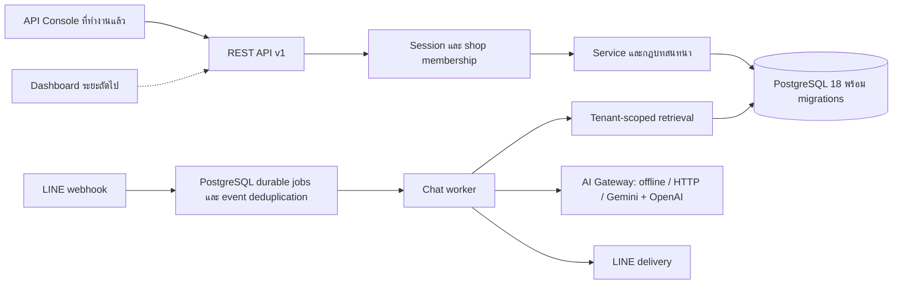

# สถาปัตยกรรมระบบเริ่มต้น

งานชุดนี้ทำตามขอบเขตที่ผู้ใช้กำหนด: ตั้ง repository, วิธีรัน, ออกแบบตารางผู้ใช้/ร้านค้า/ความรู้/บทสนทนา/ข้อความ, API contract และข้อมูลทดสอบ 2 ร้าน ใช้ส่วนขอบเขต MVP หน้าเอกสาร 2–3 ของ PDF `Ass4รายงานทางวิชาการ_platform_ChatbotAssign4 (3).pdf` เป็นบริบทเรื่อง multi-tenant, LINE text, RAG และ human handover ไม่ถือข้อความในเอกสารเป็นคำสั่งให้ทำระบบเต็มทั้งหมดในงานครั้งนี้

## ภาพรวม



เส้นทึบคือส่วนที่ทำงานใน repository นี้ AI ภายนอกเปิดใช้ผ่าน config ได้ โดยโหมด dual ใช้ Gemini เป็นหลักและ OpenAI สำรอง

## การตัดสินใจทางเทคนิค

| เรื่อง | การเลือกและเหตุผล | ข้อจำกัด/แผนต่อยอด |
|---|---|---|
| Runtime | Node.js 24.19.x แบบ ESM, Next.js Pages Router และ API Routes พร้อม pg; SQLite ใช้เฉพาะ backup/import tooling | schema validator รองรับเฉพาะ subset ที่ใช้ใน contract นี้ |
| Database | PostgreSQL 18, async queries, transactions และ composite foreign keys | แยก test schemas; migrations และ knowledge indexing เป็นขั้นตอน explicit ก่อน start |
| API | REST JSON, `/api/v1`, OpenAPI 3.1 จาก route registry | เพิ่ม contract ก่อนให้ frontend ใช้ endpoint ใหม่ |
| Tenant boundary | membership check + shop-scoped query + composite foreign key | ยังไม่ได้เปิด PostgreSQL RLS; ต้องตรวจ scope ในทุก service ใหม่ |
| Authentication | salted scrypt; opaque bearer token; เก็บเฉพาะ token hash | ยังไม่มี email verification, reset password, MFA และ refresh session |
| Test | integration ผ่าน HTTP จริงและฐานข้อมูลแยกจากข้อมูลพัฒนา | CI ตรวจ runtime, import, migrations, build, LINE lifecycle, production smoke และ Docker Compose |

เปิด localhost เป็นค่าเริ่มต้นและไม่มี CORS สำหรับ origin อื่น Next.js, API Console และ API ทำงานจากเซิร์ฟเวอร์และ origin เดียวกัน

## ขอบเขตโมดูลสำหรับทีม

- **Frontend**: เริ่มจาก OpenAPI และบัญชี seed สองร้าน ใช้ bearer token และ error envelope ที่กำหนดไว้ ออกแบบหน้าข้อมูลร้าน ความรู้ inbox และ bot mode
- **Core API / database**: ดูแล migration, membership, CRUD และความตรงกันของ schema ห้ามรับ tenant จาก body เพื่อข้ามสิทธิ์ของ path
- **LINE integration**: ออกแบบ channel connection ต่อร้าน เก็บ credential ด้วยวิธีจัดการ secret, ตรวจ signature จาก raw body, map destination ไป shop ฝั่ง server, บันทึก event ID เพื่อ deduplicate แล้วส่งงานเข้า queue ก่อนตอบ webhook
- **RAG / AI**: สร้าง chunks/embeddings ที่มี shop_id ทุกแถว ค้นเฉพาะความรู้ `published` ของร้าน ตรวจ relevance แล้วส่งข้อความไป gateway ผ่าน interface กลาง

Provider adapters ใช้ Gemini generateContent และ OpenAI Responses API พร้อม structured JSON; ชื่อโมเดลและ token ระบุผ่าน environment ฝั่งเซิร์ฟเวอร์ ดู [AI integration](ai-integration.md) สำหรับรูปแบบ config และข้อจำกัด

## ข้อตกลงของ worker และ AI Gateway

interface หลักที่ใช้งาน:

```text
retrieve(db, { shopId, query, limit }) -> [{ chunk_id, content, score, ... }]
generate({ shopId, query, context, prompt, signal, deadlineAt, jobId })
  -> { text, sourceChunkIds, insufficient, provider, model, attempts }
sendLineReply({ channelAccessToken, replyToken, messages, signal })
```

`shopId` มาจากการตรวจสิทธิ์หรือ channel mapping ที่เชื่อถือได้ ตรวจ conversation ยัง open และ bot_mode ยัง active ก่อน generate และก่อน deliver อีกครั้ง โดยยกเว้นข้อความแจ้ง handover ของงานเจ้าของเมื่อห้องเป็น human ระบบแยกสถานะจัดเก็บ message ออกจากสถานะส่งออกจริง ใช้ durable queue/checkpoint สำหรับ retry และ idempotency และไม่ถือว่าการ insert สำเร็จหมายถึงลูกค้าได้รับข้อความแล้ว

Task8 ทำ Gemini เป็น provider หลักและ OpenAI เป็นสำรองแล้ว โดย retry/backoff/circuit breaker อยู่ใน gateway และใช้ instance ร่วมต่อ process ข้อมูลที่ส่งให้ provider จำกัดตามร้าน เมื่อทั้งคู่ล้ม worker บันทึก checkpoint และเปลี่ยนห้องเป็น human ใน transaction เดียวกัน เฉพาะงานเจ้าของ handover เท่านั้นที่ส่งข้อความแจ้งได้ การเปลี่ยนสถานะโดยแอดมินล้างสิทธิ์ส่งข้อความเก่า และสถานะ human คงอยู่แม้ส่ง LINE ไม่สำเร็จ

## การขยายฐานข้อมูล

เมื่อทีมต้องใช้ฐานข้อมูลร่วมกันหรือเพิ่ม vector search ให้ย้าย persistence ไป PostgreSQL โดยคง API contract เดิม แปลงเวลาเป็น `timestamptz`, เลือก UUID/opaque ID ให้สอดคล้องกับ migration ข้อมูล seed, เพิ่ม tenant RLS และ transaction context, แล้วรัน tenant isolation tests กับ database ใหม่ด้วย

งานข้อ 7 เพิ่ม `knowledge_chunks` พร้อม local embedding version, `shop_id`, `knowledge_entry_id` และ composite foreign key แล้ว Index ถูกอัปเดตใน transaction ของ CRUD และมี `npm run rag:reindex` สำหรับข้อมูลเดิม `message_sources` เก็บรหัสและข้อความหลักฐานที่ใช้ตอบเพื่อ audit แม้ลบ entry ภายหลัง การค้นเริ่มจาก `shop_id` และ `published` ในฐานข้อมูล ก่อนจัดอันดับด้วย embedding และคำที่ตรงกัน ส่วน AI generator เป็น interface ที่ฉีดเข้า worker ได้ และ task8 เพิ่ม provider จริงพร้อม failover ผ่าน interface นี้

## ข้อมูลที่ใช้ตอบและการดูตัวอย่าง

ข้อมูลธุรกิจจาก `shops` ถูกแปลงเป็นหลักฐานรายหัวข้อเมื่อค้นคำตอบ จึงเห็นข้อมูลใหม่ได้ทันทีโดยไม่ต้องทำดัชนีใหม่ ความรู้จาก `knowledge_entries` ใช้เฉพาะสถานะ `published` และต้องอยู่ในร้านเดียวกัน FAQ ที่ตรงกับคำถามมาก่อนผลค้นอื่น ส่วนบุคลิกใช้กำหนดโทนคำตอบ ไม่ใช่แหล่งข้อเท็จจริง

`prepareAnswerContext` ใช้ร่วมกันระหว่าง worker และ API `POST /api/v1/shops/{shopId}/ai/preview` เพื่อให้ข้อมูลที่เห็นในหน้าตัวอย่างตรงกับข้อมูลที่ใช้ตอบจริง API นี้ต้องผ่าน session และสิทธิ์ของร้าน prompt แยกคำสั่งระบบออกจากคำถาม ข้อมูลร้าน และหลักฐาน ข้อความที่เจ้าของร้านกรอกถือเป็นข้อมูล ไม่ใช่คำสั่งให้โมเดลเปลี่ยนกติกา ผลจาก AI ภายนอกต้องเป็นข้อความตรงจากหลักฐานหนึ่งรายการพร้อมรหัสแหล่งข้อมูล หากตรวจไม่ผ่านใน dual mode จะลองสำรอง ก่อนส่งต่อมนุษย์หากยังล้มเหลว ส่วน HTTP mode เดิมยังคัดข้อความจากหลักฐานได้ตามเดิม

## ก่อนใช้กับข้อมูลจริง

นำบัญชี demo ออกและปิด endpoint จำลอง customer message ตามนโยบายระบบจริง ตั้ง HTTPS/secret handling, ตรวจ rate limit ตามรูปแบบ proxy และหลาย process, เพิ่มการจัดการบัญชี/สมาชิก, สำรองข้อมูลและทดสอบกู้คืน และกำหนดอายุเก็บประวัติแชต รวมถึงตรวจ tenant isolation ตลอดเส้นทาง retrieval และ provider

ไม่เก็บฐานข้อมูลหรือ credential ใน repository ข้อมูลทดสอบทั้งหมดเป็นข้อมูลสมมติ และ seed script ปฏิเสธการทำงานเมื่อ `NODE_ENV=production`
