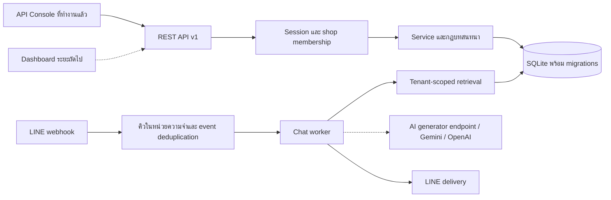

# สถาปัตยกรรมระบบเริ่มต้น

งานชุดนี้ทำตามขอบเขตที่ผู้ใช้กำหนด: ตั้ง repository, วิธีรัน, ออกแบบตารางผู้ใช้/ร้านค้า/ความรู้/บทสนทนา/ข้อความ, API contract และข้อมูลทดสอบ 2 ร้าน ใช้ส่วนขอบเขต MVP หน้าเอกสาร 2–3 ของ PDF `Ass4รายงานทางวิชาการ_platform_ChatbotAssign4 (3).pdf` เป็นบริบทเรื่อง multi-tenant, LINE text, RAG และ human handover ไม่ถือข้อความในเอกสารเป็นคำสั่งให้ทำระบบเต็มทั้งหมดในงานครั้งนี้

## ภาพรวม



เส้นทึบคือส่วนที่ทำงานใน repository นี้ เส้นประคือจุดเชื่อม AI ที่เป็นทางเลือกและ provider เฉพาะที่ยังต้องพัฒนาต่อ

## การตัดสินใจทางเทคนิค

| เรื่อง | การเลือกและเหตุผล | ข้อจำกัด/แผนต่อยอด |
|---|---|---|
| Runtime | Node.js 24.19.x แบบ ESM, Next.js Pages Router และ API Routes พร้อม SQLite/test จาก Node.js | schema validator รองรับเฉพาะ subset ที่ใช้ใน contract นี้ |
| Database | SQLite แบบ WAL, STRICT tables, foreign_keys เปิดทุก connection | เหมาะกับทีมเริ่มต้นและหนึ่ง server process; ยังไม่ใช่ shared database หลาย instance |
| API | REST JSON, `/api/v1`, OpenAPI 3.1 จาก route registry | เพิ่ม contract ก่อนให้ frontend ใช้ endpoint ใหม่ |
| Tenant boundary | membership check + shop-scoped query + composite foreign key | SQLite ไม่มี RLS; ต้องตรวจ scope ในทุก service ใหม่ |
| Authentication | salted scrypt; opaque bearer token; เก็บเฉพาะ token hash | ยังไม่มี email verification, reset password, MFA และ refresh session |
| Test | integration ผ่าน HTTP จริงและฐานข้อมูลแยกจากข้อมูลพัฒนา | มี CI config พร้อมใช้ แต่ต้องนำขึ้น remote จึงจะรัน CI บนบริการได้ |

เปิด localhost เป็นค่าเริ่มต้นและไม่มี CORS สำหรับ origin อื่น Next.js, API Console และ API ทำงานจากเซิร์ฟเวอร์และ origin เดียวกัน

## ขอบเขตโมดูลสำหรับทีม

- **Frontend**: เริ่มจาก OpenAPI และบัญชี seed สองร้าน ใช้ bearer token และ error envelope ที่กำหนดไว้ ออกแบบหน้าข้อมูลร้าน ความรู้ inbox และ bot mode
- **Core API / database**: ดูแล migration, membership, CRUD และความตรงกันของ schema ห้ามรับ tenant จาก body เพื่อข้ามสิทธิ์ของ path
- **LINE integration**: ออกแบบ channel connection ต่อร้าน เก็บ credential ด้วยวิธีจัดการ secret, ตรวจ signature จาก raw body, map destination ไป shop ฝั่ง server, บันทึก event ID เพื่อ deduplicate แล้วส่งงานเข้า queue ก่อนตอบ webhook
- **RAG / AI**: สร้าง chunks/embeddings ที่มี shop_id ทุกแถว ค้นเฉพาะความรู้ `published` ของร้าน ตรวจ relevance แล้วส่งข้อความไป gateway ผ่าน interface กลาง

รายละเอียด LINE/provider API ต้องตรวจเอกสารทางการในขั้นลงมือเชื่อมต่อจริง โค้ดชุดนี้ยังไม่ผูกชื่อรุ่นโมเดล, token หรือ webhook contract ของบริการภายนอก

## ข้อตกลงสำหรับ worker ในระยะถัดไป

interface ที่เสนอเพื่อหารือก่อนลงมือ (ยังไม่ได้ implement):

```text
retrieve({ shopId, query, limit }) -> [{ knowledgeId, content, score }]
generate({ shopId, conversationId, messages, context }) -> { text, provider, model }
deliver({ shopId, conversationId, messageId, text }) -> { deliveryId, status }
```

`shopId` ต้องมาจากการตรวจสิทธิ์หรือ channel mapping ที่เชื่อถือได้ ตรวจ conversation ยัง open และ bot_mode ยัง active ก่อน generate และก่อน deliver อีกครั้ง ต้องแยกสถานะจัดเก็บ message ออกจากสถานะส่งออกจริง เพิ่ม outbox/queue สำหรับ retry และ idempotency ไม่ถือว่าการ insert สำเร็จหมายถึงลูกค้าได้รับข้อความแล้ว

Gemini เป็น provider หลักและ OpenAI เป็นสำรองตามบริบทเอกสาร การ retry/backoff/circuit breaker ควรอยู่ใน gateway เพื่อไม่ให้ frontend หรือ LINE adapter ผูกกับ provider เฉพาะเจาะจง ข้อมูลที่ส่งให้ provider ต้องจำกัดตามร้าน

## การขยายฐานข้อมูล

เมื่อทีมต้องใช้ฐานข้อมูลร่วมกันหรือเพิ่ม vector search ให้ย้าย persistence ไป PostgreSQL โดยคง API contract เดิม แปลงเวลาเป็น `timestamptz`, เลือก UUID/opaque ID ให้สอดคล้องกับ migration ข้อมูล seed, เพิ่ม tenant RLS และ transaction context, แล้วรัน tenant isolation tests กับ database ใหม่ด้วย

งานข้อ 7 เพิ่ม `knowledge_chunks` พร้อม local embedding version, `shop_id`, `knowledge_entry_id` และ composite foreign key แล้ว Index ถูกอัปเดตใน transaction ของ CRUD และมี `npm run rag:reindex` สำหรับข้อมูลเดิม `message_sources` เก็บรหัสและข้อความหลักฐานที่ใช้ตอบเพื่อ audit แม้ลบ entry ภายหลัง การค้นเริ่มจาก `shop_id` และ `published` ในฐานข้อมูล ก่อนจัดอันดับด้วย embedding และคำที่ตรงกัน ส่วน AI generator เป็น interface ที่ฉีดเข้า worker ได้; provider จริงและ failover อยู่ในงานข้อ 8

## ก่อนใช้กับข้อมูลจริง

นำบัญชี demo ออกและปิด endpoint จำลอง customer message ตามนโยบายระบบจริง ตั้ง HTTPS/secret handling, ตรวจ rate limit ตามรูปแบบ proxy และหลาย process, เพิ่มการจัดการบัญชี/สมาชิก, สำรองข้อมูลและทดสอบกู้คืน และกำหนดอายุเก็บประวัติแชต รวมถึงตรวจ tenant isolation ตลอดเส้นทาง retrieval และ provider

ไม่เก็บฐานข้อมูลหรือ credential ใน repository ข้อมูลทดสอบทั้งหมดเป็นข้อมูลสมมติ และ seed script ปฏิเสธการทำงานเมื่อ `NODE_ENV=production`
