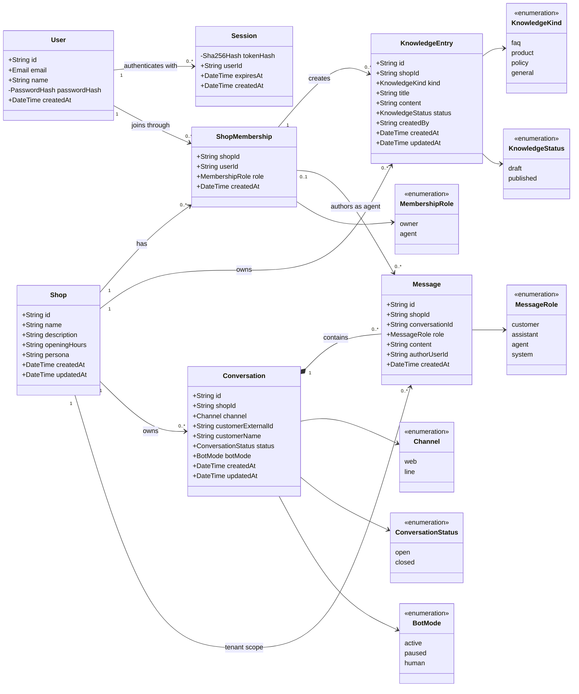

# Class Diagram: SMB Chatbot Core Domain

แผนภาพนี้แสดง class ของข้อมูลหลักจาก `migrations/001_initial.sql` และความสัมพันธ์ที่ฐานข้อมูลบังคับใช้จริง โดยใช้ชนิดข้อมูลเชิงโดเมนเพื่อสื่อความหมายมากกว่าชนิดจัดเก็บของ SQLite

## การเทียบชนิดข้อมูลกับ SQLite

| ชนิดในแผนภาพ | ชนิดใน SQLite | กฎที่สำคัญ |
|---|---|---|
| `String` / `Email` | `TEXT` | กำหนดความยาวตาม API และห้าม identifier ว่าง |
| `PasswordHash` | `TEXT` | เก็บค่า scrypt ที่เข้ารหัสรูปแบบแล้ว ไม่เก็บรหัสผ่านจริง |
| `Sha256Hash` | `TEXT` | ตัวอักษร hexadecimal พิมพ์เล็กจำนวน 64 ตัว |
| `DateTime` | `TEXT` | ISO 8601 UTC แบบ `YYYY-MM-DDTHH:mm:ss.sssZ`; รูปแบบนี้เรียงเวลาได้ถูกต้องด้วยข้อความ |
| Enumeration | `TEXT` | ใช้ `CHECK (... IN (...))` จำกัดค่าที่อนุญาต |

SQLite `STRICT` รองรับชนิดหลักเพียง `INTEGER`, `REAL`, `TEXT`, `BLOB` และ `ANY` จึงไม่ใช้ `VARCHAR`, `ENUM` หรือ `DATETIME` ใน migration โดยตรง ส่วน `CHECK` constraints ทำหน้าที่กำหนด semantic type เพิ่มเติม

`Message.authorUserId` เป็น nullable และต้องมีค่าเฉพาะเมื่อ `role = agent` เท่านั้น หากมีค่าจะต้องอ้างถึงสมาชิกของร้านเดียวกับข้อความ ความสัมพันธ์ระหว่าง `ShopMembership` กับ `KnowledgeEntry` และ `Message` จึงใช้ composite foreign key `(shop_id, user_id)` เพื่อป้องกันการอ้างผู้ใช้ข้ามร้าน
