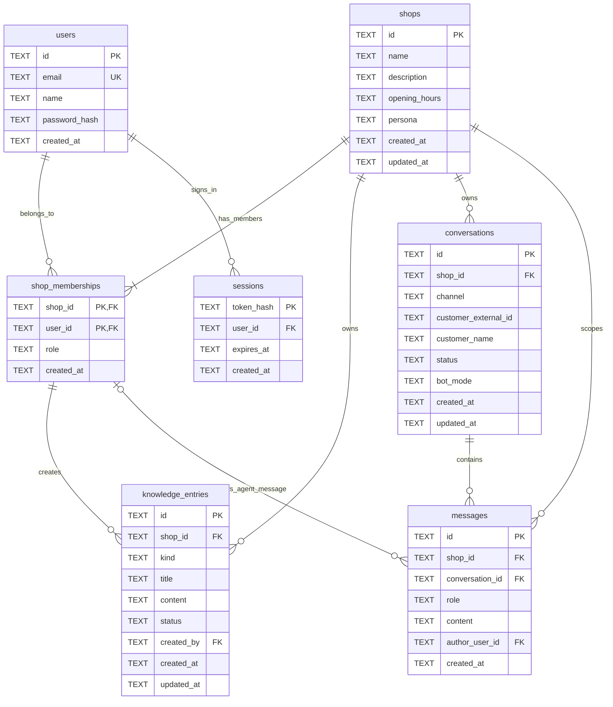

# ERD และพจนานุกรมข้อมูล v0.1.0

ชื่อ tenant ในระบบนี้คือ **shop** และใช้ `shop_id` ทุกจุด ไม่ใช้ tenant ID อีกชุดหนึ่ง บัญชีเจ้าหน้าที่อยู่ใน `users`; ลูกค้าที่ส่งแชตถูกระบุด้วย `channel` และ `customer_external_id` ภายในร้าน

## รายละเอียดตาราง

| ตาราง | ความหมายและเงื่อนไข |
|---|---|
| users | บัญชีเจ้าของร้าน/เจ้าหน้าที่; email ไม่ซ้ำโดยไม่แยกตัวพิมพ์และ API จัดเก็บเป็นตัวพิมพ์เล็ก; name 1–100 ตัวอักษร; password_hash เป็น scrypt พร้อม salt ไม่มี plaintext |
| shops | ข้อมูลธุรกิจ; name 1–120, description สูงสุด 5,000, opening_hours สูงสุด 1,000, persona สูงสุด 5,000 ตัวอักษร; ค่าที่ไม่ระบุตอนสร้างเป็นข้อความว่าง |
| shop_memberships | ตารางเชื่อมผู้ใช้กับร้าน; PK `(shop_id, user_id)`; role เป็น `owner` หรือ `agent`; ผู้สร้างร้านได้ role owner ใน transaction เดียวกัน |
| sessions | เก็บ SHA-256 ของ opaque token; อายุ 7 วัน; logout ลบ session ปัจจุบัน; API ไม่ส่ง token hash ให้ client |
| knowledge_entries | ความรู้เป็นข้อความ; kind = `faq/product/policy/general`, status = `draft/published`; title 1–200, content 1–20,000; created_by ต้องเป็นสมาชิกของร้านนั้น |
| conversations | หนึ่ง session สนทนา; channel = `web/line`; customer_external_id 1–200, customer_name 1–100; status = `open/closed`; bot_mode = `active/paused/human` |
| messages | ข้อความ text ความยาว 1–10,000; role = `customer/assistant/agent/system`; author_user_id ต้องระบุเฉพาะ role agent และต้องเป็นสมาชิกของร้าน |

ตารางธุรกิจทั้ง 7 ตารางใช้ SQLite `STRICT` ส่วน `schema_migrations(version, checksum, applied_at)` เป็นตารางโครงสร้างสำหรับติดตาม migration ไม่ใช่ข้อมูลธุรกิจ SQL ที่ใช้จริงอยู่ใน [001_initial.sql](../migrations/001_initial.sql)

ID ที่ API สร้างใหม่เป็น UUID v4 ส่วน seed ใช้ชื่อคงที่เช่น `shop-coffee` ให้ทีมทดลองได้ง่าย Client ต้องมอง ID เป็น opaque string ห้ามแยกความหมายจากรูปแบบ ID ทุกเวลาเขียนโดย server เป็น ISO 8601 UTC เช่น `2026-09-01T00:00:00.000Z` และแสดงเวลาท้องถิ่นใน frontend ได้

ไม่มี unique constraint บน `(shop_id, channel, customer_external_id)` เพราะลูกค้าคนเดียวมีหลาย conversation ได้ในแต่ละช่วงเวลา การรวมข้อความ LINE เข้าบทสนทนาที่เปิดอยู่จะกำหนดในงาน webhook ระยะถัดไป

## การแยกข้อมูลร้าน

1. ตรวจ bearer session เพื่อหา `user_id` จาก server ห้ามรับ user ID จาก client เพื่อใช้ตัดสินสิทธิ์
2. ตรวจ `shop_memberships` ตาม `shop_id` ใน path ก่อนอ่าน/เขียนข้อมูล
3. ทุก query ข้อมูลความรู้ บทสนทนา และข้อความมีเงื่อนไข `shop_id` รวมทั้งกรณี lookup ด้วย resource ID
4. `messages(shop_id, conversation_id)` เป็น composite foreign key ไปยัง `conversations(shop_id, id)` จึงสร้างข้อความอ้างบทสนทนาข้ามร้านไม่ได้
5. `knowledge_entries(shop_id, created_by)` และ `messages(shop_id, author_user_id)` อ้าง `shop_memberships(shop_id, user_id)` จึงอ้างผู้เขียนจากร้านอื่นไม่ได้

SQLite ไม่มี Row-Level Security: ข้อ 2–3 บังคับใน application และตรวจด้วย integration tests ส่วน foreign keys ป้องกันความสัมพันธ์ข้ามร้านในฐานข้อมูล ผู้ที่เข้าถึงไฟล์ฐานข้อมูลโดยตรงยังอ่านทุกแถวได้ ถ้าย้ายไป PostgreSQL ให้เพิ่ม RLS เป็นชั้นป้องกันอีกระดับ

ERD แสดงว่าร้านที่สร้างผ่าน API ต้องมีสมาชิกอย่างน้อยหนึ่งคน เงื่อนไขนี้เกิดจาก transaction สร้างร้าน; foreign key เพียงอย่างเดียวไม่ได้บังคับว่าทุกร้านต้องมี owner เสมอ ยังไม่มี endpoint ลบ/เปลี่ยน membership เพื่อป้องกันการลบ owner คนสุดท้ายโดยไม่มีกฎรองรับ

## Index และวงจรข้อมูล

- `memberships_user_idx(user_id, shop_id)` รองรับรายการร้านของผู้ใช้
- `knowledge_shop_idx(shop_id, created_at, id)` รองรับรายการความรู้
- `conversations_shop_idx(shop_id, created_at, id)` รองรับรายการบทสนทนา
- `messages_conversation_idx(shop_id, conversation_id, created_at, id)` รองรับประวัติข้อความ
- `sessions_expiry_idx(expires_at)` รองรับล้าง session หมดอายุเมื่อสร้าง session ใหม่

รายการเรียง `created_at ASC, id ASC` เพื่อให้ pagination มีลำดับแน่นอน เวลาเท่ากันใช้ ID เป็นตัวเรียงเพิ่มเติม ไม่ถือเป็นลำดับรับ event ภายนอก

API ลบได้เฉพาะ knowledge entry แบบถาวร ข้อความไม่มี endpoint แก้ไข/ลบเพื่อรักษาประวัติ ส่วน SQL เตรียม cascade เมื่อลบร้าน/บทสนทนาและ restrict ผู้ใช้ที่มี membership ไว้ แต่ยังไม่เปิด API ลบร้านหรือผู้ใช้ การกำหนด retention/export/delete ข้อมูลลูกค้าเป็นงานก่อนใช้งานจริง
